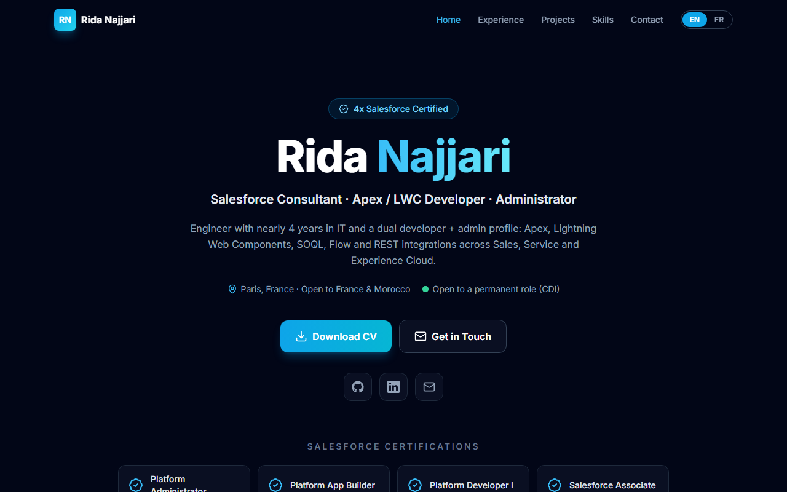
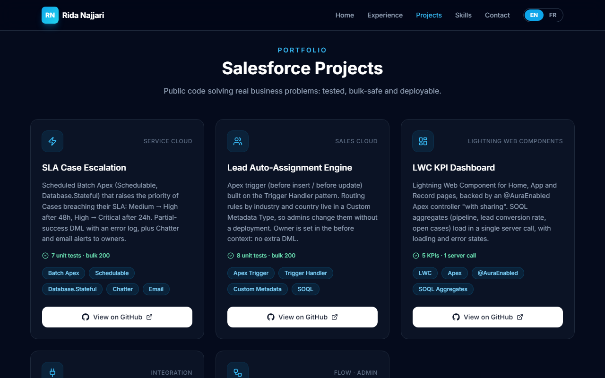
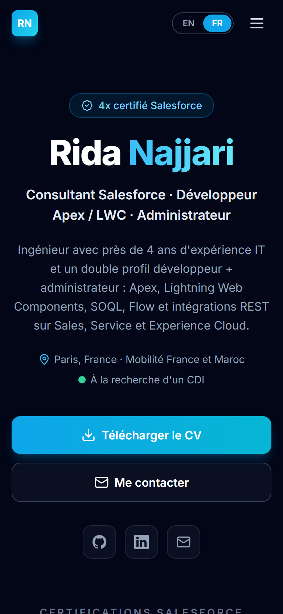

# portfolio-salesforce

Hi, I'm Rida Najjari. I'm a Salesforce consultant in Paris, currently working on Sales Cloud and Service Cloud at Vulcain Engineering Group. I do both development (Apex, LWC, Flow, integrations) and administration, and I hold 4 Salesforce certifications: Platform Administrator, Platform App Builder, Platform Developer I and Associate.

This repo is the code of my personal website. I wanted one place where a recruiter or a tech lead can quickly see my background and open the code of the Salesforce projects I've built, instead of only reading a PDF.

**You can visit it here: [rida-najjari.netlify.app](https://rida-najjari.netlify.app/)**



## What's on the site

- A short intro, my certifications and a button to download my CV
- My experience (Vulcain Engineering Group, Dell Technologies, Sofrecom) and education (Institut F2i, EMSI)
- My Salesforce projects, each with a link to its GitHub repo
- My skills, grouped by area
- A contact section with my email, LinkedIn and a small form

The whole site works in English and French. I'm looking for a job in France, but I also wanted it readable for international teams, so there's an EN / FR switch in the menu.



## My Salesforce projects

These are the projects shown on the site. Each one has its own repo with the code, tests and a README explaining the business need.

| Project | Description |
|---|---|
| [case-escalation-automation](https://github.com/ridanajjari/case-escalation-automation) | Scheduled Batch Apex that raises the priority of Cases that break their SLA and notifies the owner by Chatter and email. 7 test methods, including a 200-record bulk test. |
| [lead-auto-assignment](https://github.com/ridanajjari/lead-auto-assignment) | Apex trigger that assigns Leads by industry and country. The rules are stored in Custom Metadata, so an admin can change them without a deployment. 8 test methods. |
| [lwc-kpi-dashboard](https://github.com/ridanajjari/lwc-kpi-dashboard) | Lightning Web Component showing pipeline, open cases and lead conversion rate, loaded from Apex in a single call. |
| [salesforce-api-integration](https://github.com/ridanajjari/salesforce-api-integration) | Apex callout to an external REST API through a Named Credential, with JSON parsing, error handling and mocked tests. |
| [admin-flow-toolkit](https://github.com/ridanajjari/admin-flow-toolkit) | Five Flows I reuse for common admin needs: welcome email, approval reminder, duplicate check, case auto-close and lead follow-up. |

## How I built it

I kept it simple: React 18 with Vite, Tailwind CSS for styling and lucide-react for icons. There's no backend. The contact form just opens the visitor's email app with the message already filled in.

All the content (texts in both languages, experience, projects, skills) sits at the top of `src/App.jsx`, so when something changes in my career I only have to edit that part. The CV you download from the site is `public/Rida_Najjari_CV_Salesforce.pdf`.

I checked the layout on phone and desktop sizes. On mobile it looks like this:



## Running it locally

```bash
npm install
npm run dev
```

Then open http://localhost:5173. `npm run build` creates the production version in `dist/`.

I host the site on Netlify at [rida-najjari.netlify.app](https://rida-najjari.netlify.app/). The build settings are in `netlify.toml`, and every time I push to `main` the site updates on its own.

## Contact

If you're hiring for a Salesforce consultant, developer or admin role, I'd be happy to talk.

- Website: [rida-najjari.netlify.app](https://rida-najjari.netlify.app/)
- Email: najjaririda6@gmail.com
- LinkedIn: [linkedin.com/in/rida-najjari](https://www.linkedin.com/in/rida-najjari)
